## Dynamic Configuration of Organogram and Location Hierarchy

A proof of concept for the new **PMS (Performance Management System)** backend and UI. It shows how the core HR master data that PMS depends on (locations, the organogram, grades, designations, sanctioned posts and employees) can be modelled, validated and managed in the new stack. It uses the standard Spring layering:

- **Controller** → validates the body with Bean Validation (`@Valid`) and calls one service method
- **Service** → the only `@Transactional` layer; enforces business rules and publishes domain events
- **After commit** → `@TransactionalEventListener(phase = AFTER_COMMIT)` listeners send mail

There is no security in this POC. Progress and open questions are tracked in [POC_NOTES.md](POC_NOTES.md).

---

## Technology

| Layer | Technology |
|---|---|
| Language / runtime | Java 25 |
| Backend framework | Spring Boot 3.5.6 (Web, Data JPA / Hibernate, Validation, Actuator) |
| Validation | Jakarta Bean Validation (Hibernate Validator), with validation groups (`OnUpdate`) |
| Events | Spring application events + `@TransactionalEventListener` (after-commit side effects) |
| Database | PostgreSQL (dev/runtime), H2 in PostgreSQL mode (tests) |
| Schema migrations | Flyway (`V1`–`V4` under `src/main/resources/db/migration`) |
| API docs | springdoc-openapi 2.8.13 (Swagger UI) |
| Boilerplate | Lombok 1.18 (getters, constructors, loggers; version managed by Spring Boot) |
| Build | Maven 3.9+ |
| Tests | JUnit 5, Spring Boot Test, ArchUnit 1.4 (layer rules), JaCoCo 0.8.14 (code coverage) |
| Frontend | Angular 22 (standalone components, signals, lazy routes), Angular Material / CDK 22, RxJS 7.8, TypeScript 6 |
| Fonts / icons | Roboto (`@fontsource/roboto`), Material Symbols Outlined (`material-symbols`), both self-hosted from npm |
| Frontend tooling | Angular CLI, Node 20.19+ or 22+, npm, Prettier |
| Scripts | Bash + `psql` (`scripts/reset-db.sh`) |

---

## Features

- **Type-wise locations.** One configurable location tree replaces separate Division / District / Upazila tables. Location types and their levels are data, not code. All of Bangladesh is preloaded: 8 divisions, 64 districts and 495 upazilas, coded with official BBS geocodes.
- **Organogram.** A configurable org unit tree (Organization → Function → Department → Unit → Team), with a FUNCTIONAL / NON_FUNCTIONAL nature on each unit. Child units inherit the nature unless they set one.
- **Grades and designations.** Grades are ranked (1 = most senior), and each designation belongs to one grade.
- **Sanctioned posts.** Each org unit has a sanctioned head count per designation, shown as sanctioned / filled / vacancy.
- **Employee CRUD.** Paged search with filters for org unit, location, designation and status. The org unit and location filters include the whole subtree. Each employee has a supervisor, and reporting loops are rejected.
- **Hierarchy rules enforced on the server.** Level rules, no move into your own subtree, no deleting a node that still has children or is still in use, and optimistic locking with `version`.
- **Consistent API responses.** Every response is `{ success, message, data }`, with clear HTTP status rules (see below).
- **Angular UI.** Screens for employees, an org chart and tree view, a location tree and setup (types, grades, designations).
- **Architecture guard.** `ArchitectureTest` (ArchUnit) fails the build when a layer rule is broken.

---

## Screenshots

Click any image to see it at full size.

<table>
  <tr>
    <td width="50%" valign="top">
      <a href="screenshots/employee_list.png">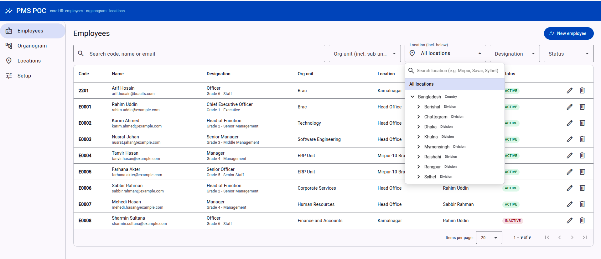</a>
      <br><b>Employee list</b>
      <br><sub>Paged employee search with filters for org unit, location, designation and status. The location filter is a searchable tree and includes everything below the chosen node.</sub>
    </td>
    <td width="50%" valign="top">
      <a href="screenshots/organogram.png">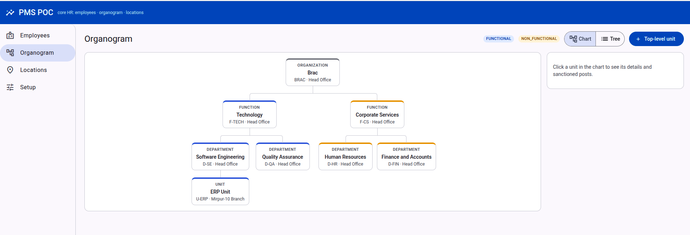</a>
      <br><b>Organogram</b>
      <br><sub>Org chart from Organization down to Unit, colour-coded FUNCTIONAL / NON_FUNCTIONAL. Switch to Tree view, or click a unit to see its details and sanctioned posts.</sub>
    </td>
  </tr>
  <tr>
    <td width="50%" valign="top">
      <a href="screenshots/location_config.png">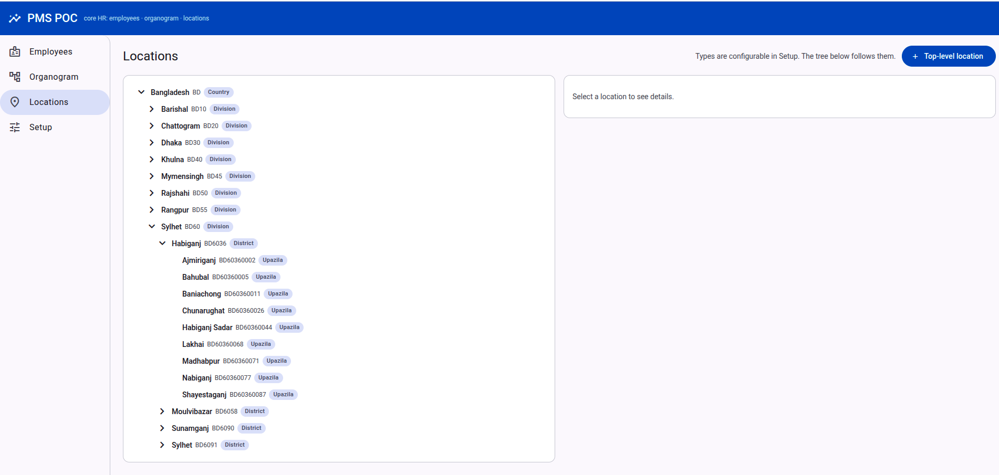</a>
      <br><b>Location tree</b>
      <br><sub>All of Bangladesh preloaded as one tree (Country → Division → District → Upazila) with official BBS geocodes.</sub>
    </td>
    <td width="50%" valign="top">
      <a href="screenshots/location_type.png">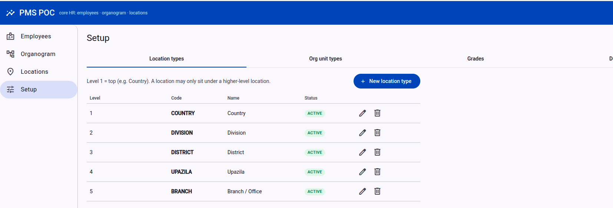</a>
      <br><b>Setup: location types</b>
      <br><sub>Location levels are data, not code. Add, reorder or deactivate types; a location may only sit under a higher level.</sub>
    </td>
  </tr>
  <tr>
    <td width="50%" valign="top">
      <a href="screenshots/organization_type.png">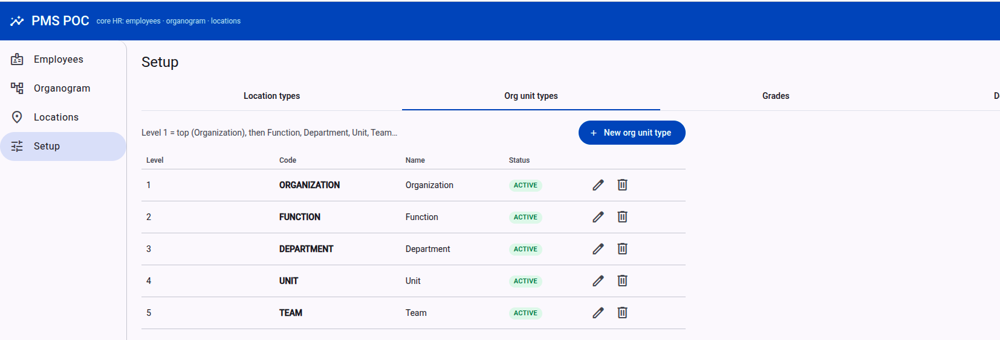</a>
      <br><b>Setup: org unit types</b>
      <br><sub>Configurable organogram levels: Organization, Function, Department, Unit, Team.</sub>
    </td>
    <td width="50%" valign="top">
      <a href="screenshots/designation.png">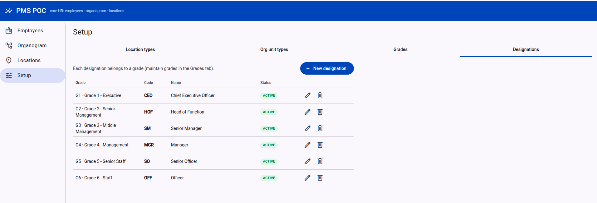</a>
      <br><b>Setup: designations</b>
      <br><sub>Each designation belongs to one ranked grade, from G1 (Executive) to G6 (Staff).</sub>
    </td>
  </tr>
</table>

---

## How to run

### Prerequisites

- JDK 25 and Maven 3.9+
- PostgreSQL on `localhost:5433` with a database named `pmspoc` (user `postgres`, password `postgres`), plus the `psql` client for the setup and reset commands
- Node 20.19+ or 22+ and npm (for the UI)
- In your IDE, the Lombok plugin with annotation processing turned on. IntelliJ IDEA bundles the plugin; Eclipse and VS Code need the Lombok extension. Maven builds need nothing extra.

### 1. Backend

```bash
# once, if the database doesn't exist yet
psql -h localhost -p 5433 -U postgres -c "CREATE DATABASE pmspoc"

mvn spring-boot:run          # http://localhost:8080
```

On startup, Flyway creates the tables (`V1__corehr_schema.sql`) and loads sample data (`V2__corehr_seed_data.sql`). It then adds the Grade entity (`V3__grade_entity.sql`) and the Bangladesh divisions, districts and upazilas (`V4__bangladesh_admin_locations.sql`).

To use other connection details, set `DB_URL`, `DB_USERNAME` and `DB_PASSWORD`.

- Swagger UI: http://localhost:8080/swagger-ui.html
- Health: http://localhost:8080/actuator/health

To wipe the database and let Flyway rebuild it from scratch:

```bash
bash scripts/reset-db.sh     # then: mvn spring-boot:run
```

### 2. Frontend

```bash
cd frontend
npm install
npm start                    # http://localhost:4200
```

The dev server proxies `/api/*` to `http://localhost:8080`, so start the backend first. See [frontend/README.md](frontend/README.md) for more.

### 3. Tests

Tests use in-memory H2 in PostgreSQL mode, so they don't need a database:

```bash
mvn test
```

#### Code coverage (JaCoCo)

```bash
mvn verify                   # runs the tests, then writes the coverage report
xdg-open target/site/jacoco/index.html   # macOS: open, Windows: start
```

The report is in `target/site/jacoco/` (`index.html` for browsing, `jacoco.xml` / `jacoco.csv` for CI tools such as SonarQube). `App` and Lombok-generated code (marked `@Generated` via `lombok.config`) are left out.

<a href="screenshots/test_coverage.png">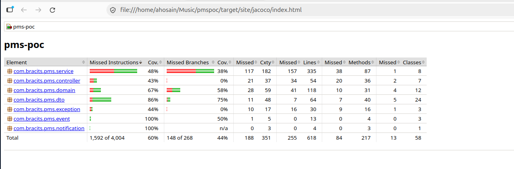</a>
<br><sub>JaCoCo report by package: 60% instruction coverage and 44% branch coverage overall.</sub>

#### Manual API testing (Swagger UI)

With the backend running, open http://localhost:8080/swagger-ui.html to try every endpoint from the browser. Endpoints are grouped by resource; expand one, click **Try it out**, fill in the parameters or body and click **Execute**. The raw OpenAPI spec is at http://localhost:8080/v3/api-docs.

<a href="screenshots/swagger.png">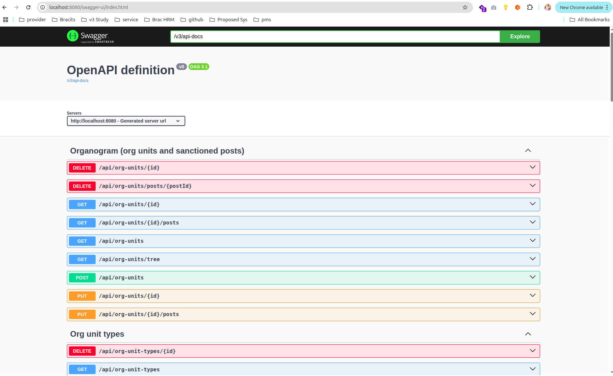</a>
<br><sub>Swagger UI (springdoc-openapi): endpoints grouped by resource, e.g. the organogram's org units and sanctioned posts.</sub>

---

## Location configuration

Locations are not hard-coded tables. There are two tables:

- **`location_type`** holds the levels (`code`, `name`, `level_no`; 1 = top).
- **`location`** holds the actual places (`code`, `name`, `location_type_id`, `parent_id`), stored as a tree with a materialized `path` such as `/1/12/85/`.

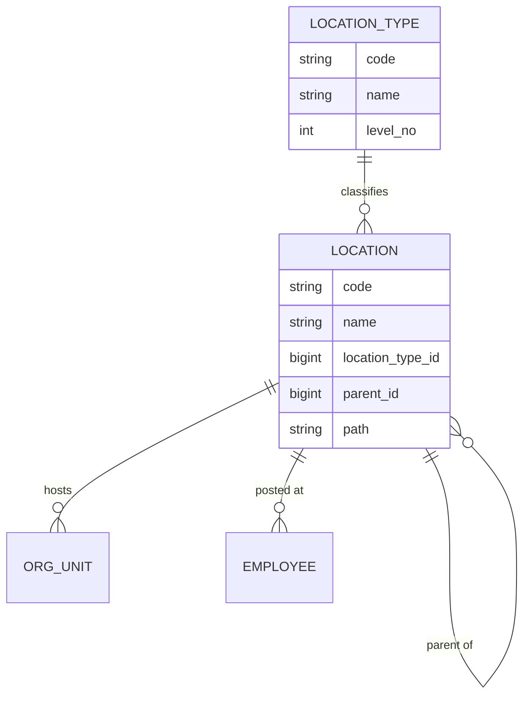

### Level rules

- A level 1 type (for example, COUNTRY) is a root and has no parent.
- Any other location needs a parent whose type has a **smaller** `level_no`.
- Levels may be **skipped**. For example, an office can sit directly under a district.
- A location can't be moved under itself or its own children, and a location with children can't be deleted.

### Example: the configured types

| level_no | code | name |
|---|---|---|
| 1 | `COUNTRY` | Country |
| 2 | `DIVISION` | Division |
| 3 | `DISTRICT` | District |
| 4 | `UPAZILA` | Upazila |
| 5 | `BRANCH` | Branch / Office |

### Example: part of the loaded tree

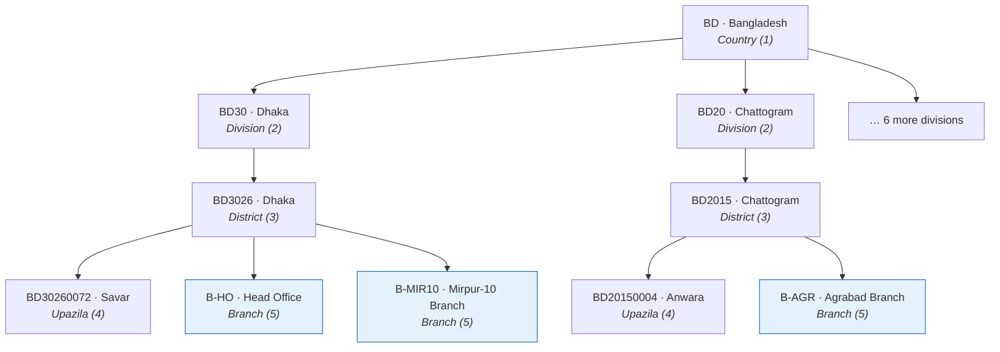

The branches sit directly under their district, skipping the Upazila level, because Dhaka and Chattogram city areas are not upazilas.

### Example: add a new level and a location

```bash
# 1. add a "Union" type between Upazila (4) and Branch:
#    first give BRANCH level 6 (PUT /api/location-types/{id}), then create UNION at level 5
curl -s -X POST localhost:8080/api/location-types -H 'Content-Type: application/json' \
  -d '{"code":"UNION","name":"Union","levelNo":5}' | jq

# 2. add a branch under the Dhaka district (a level is skipped, which is allowed)
curl -s -X POST localhost:8080/api/locations -H 'Content-Type: application/json' \
  -d '{"code":"B-DHN","name":"Dhanmondi Branch","typeId":<BRANCH id>,"parentId":<BD3026 id>}' | jq

# 3. read the tree, or just one subtree
curl -s localhost:8080/api/locations/tree | jq
curl -s "localhost:8080/api/locations/tree?rootId=<BD3026 id>" | jq
```

> Look up real ids with `GET /api/location-types` and `GET /api/locations?q=Dhaka`, or check the exact field names in Swagger UI.

---

## Organogram

The organogram uses the same pattern as locations:

- **`org_unit_type`** holds the levels.
- **`org_unit`** holds the tree. Each unit has a type, an optional **nature** (`FUNCTIONAL` / `NON_FUNCTIONAL`), a parent, a location and a sort order.
- **`grade`** → **`designation`** gives each designation a grade.
- **`org_unit_post`** holds the sanctioned head count for each designation in each unit.
- **`employee`** belongs to one org unit, designation and location, and may have a supervisor.

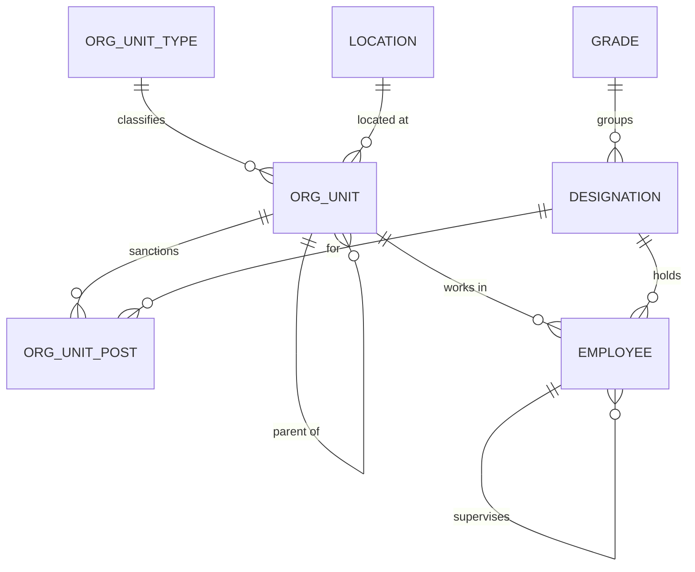

### Configured levels, grades and designations

| level_no | Org unit type | | Grade (rank) | Designation |
|---|---|---|---|---|
| 1 | Organization | | G1 – Executive (1) | CEO – Chief Executive Officer |
| 2 | Function | | G2 – Senior Management (2) | HOF – Head of Function |
| 3 | Department | | G3 – Middle Management (3) | SM – Senior Manager |
| 4 | Unit | | G4 – Management (4) | MGR – Manager |
| 5 | Team | | G5 – Senior Staff (5) | SO – Senior Officer |
| | | | G6 – Staff (6) | OFF – Officer |

The same level rules as for locations apply. In addition, a unit's type can't be changed to a level at or below the level of its existing children.

### Example: the sample organogram

Green units are FUNCTIONAL and orange units are NON_FUNCTIONAL. Each box shows its sanctioned posts.

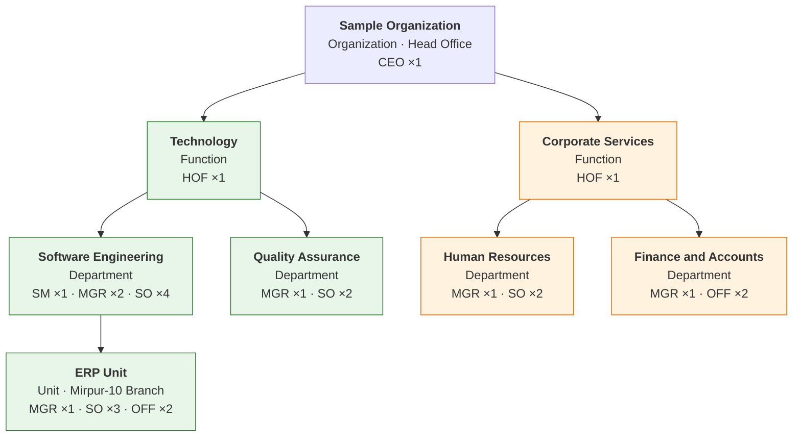

### Example: reporting lines of the sample employees

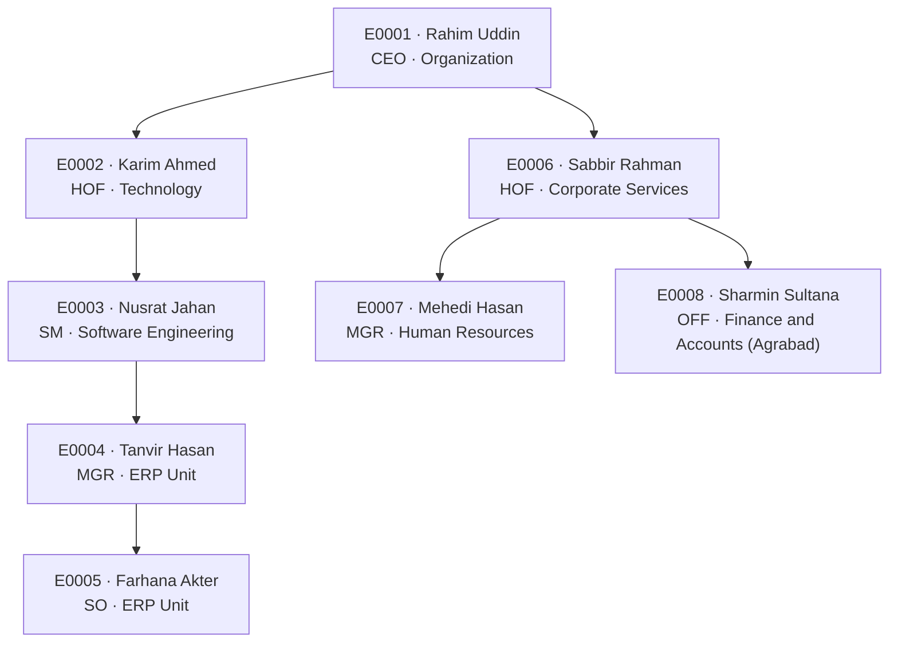

### Example: working with the organogram

```bash
# full org chart, or just the Technology function and everything below it
curl -s localhost:8080/api/org-units/tree | jq
curl -s "localhost:8080/api/org-units/tree?rootId=2" | jq

# sanctioned vs filled posts of the ERP Unit
curl -s localhost:8080/api/org-units/8/posts | jq

# everyone anywhere under Technology (the filter includes the subtree)
curl -s "localhost:8080/api/employees?orgUnitId=2" | jq

# only support units
curl -s "localhost:8080/api/org-units?nature=NON_FUNCTIONAL" | jq
```

---

## Code layout

```
com.bracits.pms
 ├── controller/      REST controllers
 ├── dto/             ApiResponses (response builder), OnUpdate (validation group)
 │    └── record/     request forms, response views, search params, tree nodes, ApiResponse, PageView
 ├── service/         business logic + transaction boundaries
 ├── repository/      Spring Data JPA repositories
 ├── domain/          JPA entities, enums, BaseEntity, HierarchyPath
 ├── event/           domain events + the after-commit mail listener
 ├── exception/       BusinessException, NotFoundException, GlobalExceptionHandler
 └── notification/    NotificationService (logs only)

frontend/src/app
 ├── core/        api.service, models, error.interceptor, notify.service, lookups
 ├── shared/      tree-view, tree-utils, location-picker, confirm-dialog
 └── features/    employees/ · organogram/ · locations/ · setup/
```

`ArchitectureTest` (ArchUnit) fails the build if a layer rule is broken. For example, it fails if anything outside a `service` package is `@Transactional`, a controller uses a repository, a repository is used outside a service, or a service sends mail directly (services publish events instead).

### Lombok conventions

Lombok generates the repetitive code at compile time. `pom.xml` registers it as an annotation processor, because JDK 23+ no longer runs processors that are only on the classpath, and leaves it out of the runnable jar.

| Where | Annotation | Replaces |
|---|---|---|
| Controllers, services, listeners | `@RequiredArgsConstructor` | the constructor that injects the `private final` dependencies |
| Entities (and `BaseEntity`) | `@Getter` | hand-written getters |
| Entities | `@NoArgsConstructor(access = AccessLevel.PROTECTED)` | the empty constructor JPA needs |
| Classes that log | `@Slf4j` | `private static final Logger log = LoggerFactory.getLogger(...)` |

Rules:
- **No `@Setter` or `@Data` on entities.** Entities change only through intent methods such as `change(...)`, `refreshPath()` and `assertVersion(...)`. `@Data` would also generate `equals`/`hashCode`/`toString` that walk lazy relations.
- **DTOs stay Java `record`s** (`*Form`, `*View`, `*Node`, `*Search`). They don't need Lombok. Input rules live on the `*Form` records as Bean Validation annotations.

## The flow

Reads (e.g. `GET /api/employees`): the controller calls `employeeService.search(...)`, which is `@Transactional(readOnly = true)`, and wraps the data with `ApiResponses.ok(data)`. Writes follow the same path, using "create employee" as the example:

```
POST /api/employees
  EmployeeController.create(@Valid form)
    0. Bean Validation on EmployeeForm   -> invalid? MethodArgumentNotValidException -> 400, nothing saved
    1. employeeService.create(form)      (@Transactional)
         - referenced records exist & ACTIVE?  no -> NotFoundException (404) / BusinessException (409)
         - code / email unique?                no -> BusinessException -> rollback -> 409
         - save, then publish EmployeeCreatedEvent
       commit
    2. EmployeeNotificationListener.onCreated   (@TransactionalEventListener AFTER_COMMIT)
         -> notificationService.send(...)      (never runs if the transaction rolled back)
  <- 201 {"success":true,"message":"Employee E0100 created","data":{...}}
```

## API overview

| Resource | Endpoints |
|---|---|
| Location types | `GET/POST /api/location-types`, `PUT/DELETE /api/location-types/{id}` |
| Locations | `GET /api/locations?typeId=&parentId=&q=`, `GET /api/locations/tree?rootId=`, `GET/PUT/DELETE /api/locations/{id}`, `POST /api/locations` |
| Org unit types | `GET/POST /api/org-unit-types`, `PUT/DELETE /api/org-unit-types/{id}` |
| Org units | `GET /api/org-units?typeId=&parentId=&nature=&q=`, `GET /api/org-units/tree?rootId=`, `GET/PUT/DELETE /api/org-units/{id}`, `POST /api/org-units` |
| Sanctioned posts | `GET/PUT /api/org-units/{id}/posts`, `DELETE /api/org-units/posts/{postId}` |
| Grades | `GET/POST /api/grades`, `PUT/DELETE /api/grades/{id}` |
| Designations | `GET/POST /api/designations`, `PUT/DELETE /api/designations/{id}` (body has `gradeId`) |
| Employees | `GET /api/employees?q=&orgUnitId=&locationId=&designationId=&status=&page=&size=`, `GET/PUT/DELETE /api/employees/{id}`, `POST /api/employees` |

`orgUnitId` and `locationId` on the employee search include the whole subtree. For example, `?orgUnitId=2` returns everyone anywhere under the Technology function.

### Try it

```bash
# create an employee (designation 6 = Officer, org unit 8 = ERP Unit, location 8 = Mirpur-10 Branch, supervisor 7 = E0004)
curl -s -X POST localhost:8080/api/employees -H 'Content-Type: application/json' -d '{
  "employeeCode":"E0100","fullName":"New Person","email":"new.person@example.com",
  "joinDate":"2025-01-01","designationId":6,"orgUnitId":8,"locationId":8,"supervisorId":7}' | jq

# invalid input fails Bean Validation: 400 and nothing is saved
curl -s -X POST localhost:8080/api/employees -H 'Content-Type: application/json' -d '{"employeeCode":"X"}' | jq

# update: send back the version you loaded, or you'll get 409
curl -s -X PUT localhost:8080/api/employees/9 -H 'Content-Type: application/json' -d '{
  "employeeCode":"E0100","fullName":"New Person Renamed","email":"new.person@example.com",
  "joinDate":"2025-01-01","designationId":6,"orgUnitId":8,"locationId":8,"supervisorId":7,"version":0}' | jq
```

## HTTP status rules

| Status | When |
|---|---|
| 200 / 201 | Success |
| 400 | Bean Validation failed (required field, length, format), or the JSON is malformed. `data` holds `{ field: message }` |
| 404 | The record (or a record it references) does not exist |
| 409 | A business rule broke inside the service transaction (duplicate code/email/rank, level rule, move into own subtree, reporting loop, stale `version`, still in use) |
